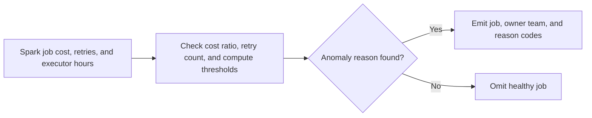

# Spark Job Cost Anomaly Detector

Detects Spark training and feature engineering jobs whose runtime cost or retry behavior is outside expected bounds.

Focus: Spark, ML training reliability, cloud cost guardrails, SRE.

Portfolio framing: Apple-scale client-style platform project using synthetic data only.

## Run

```bash
python3 spark_cost_anomaly.py sample_jobs.csv
```

## Verify

```bash
python3 -m unittest discover . -v
```

## Local verification

Run `make verify` with Make and Python 3 installed. The target runs the documented sample through the project CLI. It also runs the existing Python unit tests.

## Business problem

A Spark workload can finish successfully while a retry storm or resource spike drives cost above its baseline.

## Project walkthrough



[Architecture and data flow](docs/ARCHITECTURE.md) · [Business problem, demo, and verification](docs/CASE_STUDY.md)

## Run the project

### Local setup

Run `make verify` with Python 3 and Make installed.

### CLI usage

```sh
python3 spark_cost_anomaly.py sample_jobs.csv
```

### Replay usage

Run `make replay` to replay the checked-in inputs. The runner compares stdout with the baseline, reports differences, and exits nonzero on regression.

[Replay cases](examples/replay-manifest.json) · [Generated report](reports/replay.md) · [Rule implementation](docs/RULES.md)

### Run tests

[Verification report](reports/verification.md) · [Business problem, sample behavior, and limitations](docs/CASE_STUDY.md)


### Limitations

The verification report covers the bundled local examples. See the [case study](docs/CASE_STUDY.md) for project-specific assumptions and operating limits.

## Development and security

See the [developer setup, tool roles, and security checks](docs/DEVELOPMENT.md).

[Local check results](reports/devsecops.md)
