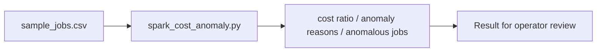

# Spark Job Cost Anomaly Detector architecture

Detects Spark training and feature engineering jobs whose runtime cost or retry behavior is outside expected bounds.

## Operational boundaries

The documented run evaluates the bundled sample locally. Results depend on the quality and scope of the input. The demo makes no live infrastructure changes.
